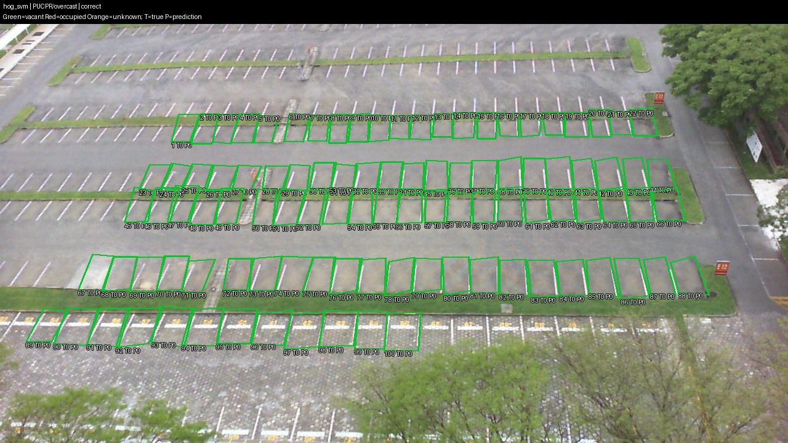
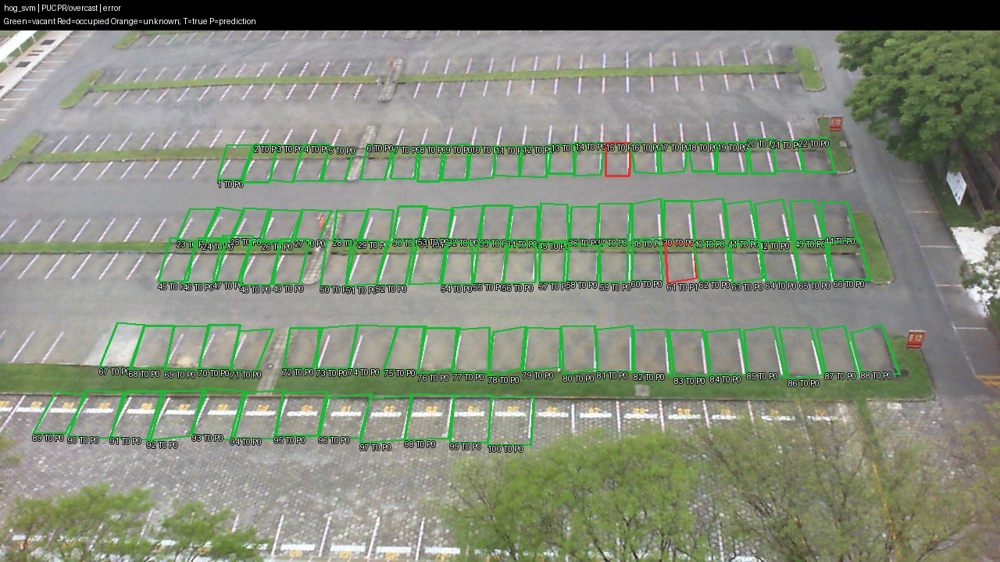
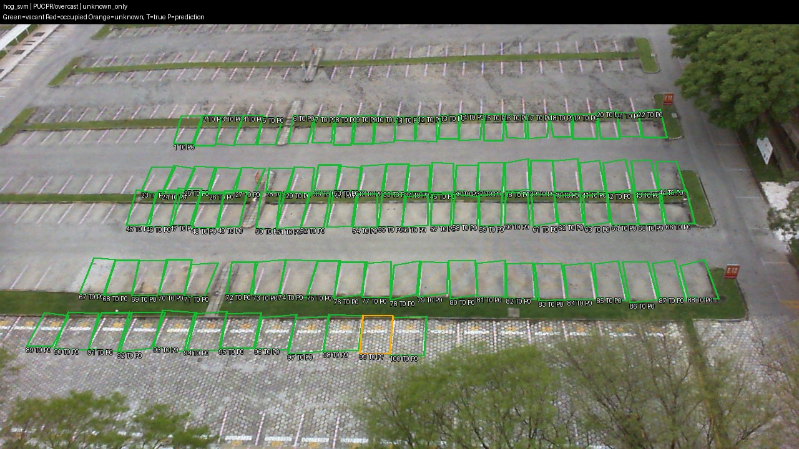

# Kết quả test cuối — cấu hình validation_v1

**Task 13 đã hoàn tất từ lượt chạy ngày 11/11/2026.** Bộ bằng chứng này được tìm lại và xác minh ngày 16/11/2026, sau đó đưa từ output local lên repository. Không huấn luyện, chọn tham số hay suy luận lại để tạo báo cáo này.

Cùng 270 ảnh test / 15.120 ô cho cả bốn phương pháp, giao thức `within_camera`, thiết bị CPU. Hash khóa validation: `931ebc8a916c7e00fe6c5c1206a6bb4e3e5574769a8ba0f2859e3558ad2b972a`.

| Phương pháp | Precision | Recall | F1 | Accuracy | Coverage | MAE ô trống | ms/ảnh CPU |
|---|---:|---:|---:|---:|---:|---:|---:|
| HOG + SVM | 0.9426 | 0.9893 | 0.9654 | 0.9126 | 0.9353 | 4.681 | 167.8 |
| YOLO full 640 | 0.9955 | 0.2256 | 0.3679 | 0.6767 | 0.9015 | 15.807 | 165.3 |
| Hybrid | 0.9987 | 0.4836 | 0.6517 | 0.7583 | 0.9026 | 11.400 | 386.5 |
| YOLO full pixel-matched | 0.9987 | 0.4547 | 0.6249 | 0.7487 | 0.8955 | 11.563 | 377.9 |

## Đọc kết quả

Hybrid có ΔF1=+0.2838 so với full640 và +0.0268 so với full khớp pixel; tổng thời gian cao hơn đối chứng khớp pixel 8.6 ms/ảnh trong lượt đo này. Chưa thực hiện kiểm định ý nghĩa thống kê.
HOG/SVM được học trên crop PKLot cùng các camera của giao thức; YOLO11n dùng trọng số COCO giữ nguyên. Không suy ra rằng phương pháp truyền thống luôn tốt hơn học sâu hoặc đã tổng quát sang camera/bãi mới.
Pixel hybrid và full độ phân giải cao đã được kiểm tra bằng nhau trên từng ảnh. Pixel bằng nhau không đồng nghĩa FLOPs hay latency bằng nhau. Timing gồm toàn bộ ảnh gốc và tất cả tile; model stage còn gồm xử lý nội bộ Ultralytics/NMS/mapping, không chỉ forward mạng. Một lượt CPU có thể chịu tải máy; không so trực tiếp với GPU Colab.

## Bảng và dự đoán để viết task 17–18

- [Bảng tổng](tables/comparison.csv).
- [Theo camera](tables/by_camera.csv), [theo thời tiết](tables/by_weather.csv), [camera × thời tiết](tables/by_camera_weather.csv).
- [Ma trận nhầm lẫn 2×3](tables/confusion_matrices.csv), [thời gian từng giai đoạn theo ảnh](tables/timings_per_frame.csv).
- Mỗi thư mục phương pháp giữ metrics tổng/theo nhóm, dự đoán từng ô, ground truth đã ghép, timing và ngân sách pixel. Unknown bị tính sai trong accuracy tổng, có coverage riêng.
- [Thông tin lượt chạy](workflow_status.json), [test_summary.json](test_summary.json), [provenance.json](provenance.json).

- [HOG + SVM](hog_svm/): [dự đoán](hog_svm/predictions.jsonl), [dự đoán đã ghép nhãn](hog_svm/aligned_predictions.jsonl), [metrics](hog_svm/metrics.json), [timing](hog_svm/timings.jsonl).
- [YOLO full 640](yolo_fullframe/): [dự đoán](yolo_fullframe/predictions.jsonl), [dự đoán đã ghép nhãn](yolo_fullframe/aligned_predictions.jsonl), [metrics](yolo_fullframe/metrics.json), [timing](yolo_fullframe/timings.jsonl).
- [Hybrid](yolo_hybrid/): [dự đoán](yolo_hybrid/predictions.jsonl), [dự đoán đã ghép nhãn](yolo_hybrid/aligned_predictions.jsonl), [metrics](yolo_hybrid/metrics.json), [timing](yolo_hybrid/timings.jsonl).
- [YOLO full pixel-matched](yolo_fullframe_highres/): [dự đoán](yolo_fullframe_highres/predictions.jsonl), [dự đoán đã ghép nhãn](yolo_fullframe_highres/aligned_predictions.jsonl), [metrics](yolo_fullframe_highres/metrics.json), [timing](yolo_fullframe_highres/timings.jsonl).

## Ảnh minh họa

Có đủ **88 ảnh overlay trạng thái ô**, giữ nguyên byte từ lượt gốc. [Toàn bộ ảnh](examples/), [quy tắc và mẫu đã chọn](examples/selection.json), [số mẫu theo nhóm](examples/availability.csv).
Mỗi phương pháp/camera/thời tiết chọn sample_id đầu theo thứ tự trong từng loại: correct là toàn bộ ô đúng/xác định; error có dự đoán xác định sai; unknown_only có từ chối nhưng không có lỗi xác định. Nhóm không có mẫu ghi available=0. Đây là ảnh trạng thái ô, không có raw box detector.
Màu xanh=trống, đỏ=có xe, cam=chưa xác định; T=nhãn thật, P=dự đoán.

### correct

hog_svm · PUCPR/overcast · `PUCPR/Cloudy/2012-10-12/2012-10-12_09_12_38`

### error

hog_svm · PUCPR/overcast · `PUCPR/Cloudy/2012-10-12/2012-10-12_09_17_38`

### unknown_only

hog_svm · PUCPR/overcast · `PUCPR/Cloudy/2012-10-12/2012-10-12_06_02_29`

## Tính toàn vẹn và lịch sử test

Đã tính lại evaluator từ dự đoán/timing đã lưu: đủ 270 frame và 15.120 ô cho mỗi phương pháp; metrics tổng và các nhóm khớp. Đã kiểm tra toàn bộ 127 file trong manifest gốc và đủ 88 ảnh.
`source_evidence_sha256.json` giữ manifest byte của output gốc. Bản công bố chuẩn hóa xuống dòng văn bản sang LF để Git trên Windows không đổi checksum; `evidence_sha256.json` là manifest tương ứng với các file công bố hiện tại. Không dùng manifest byte gốc để kiểm tra bản đã chuẩn hóa LF. Giá trị số, dự đoán và ảnh không đổi.
Trường `inputs.test_inference_performed=false` trong workflow_status mô tả riêng bước kiểm tra đầu vào trước suy luận. Trạng thái ngoài cùng `status=complete`, bốn bộ dự đoán/timing và test_summary mới xác nhận lượt test đã hoàn tất.
Notebook lịch sử commit `293893d` từng hiển thị test với cấu hình cũ. Lượt này dùng cấu hình chọn trên validation và không chọn tham số từ test, nhưng **không được gọi test v1 là holdout chưa từng quan sát**. Giao thức chuyển camera chưa được đánh giá ở đây.

Ảnh minh họa có nguồn từ [PKLot, UFPR](https://web.inf.ufpr.br/vri/databases/parking-lot-database/). Trích dẫn: Almeida et al., *PKLot – A robust dataset for parking lot classification*, Expert Systems with Applications 42(11):4937–4949, 2015. Dataset công bố theo CC BY 4.0. Không đưa archive, ảnh/XML gốc, checkpoint hoặc model vào thư mục báo cáo này.
